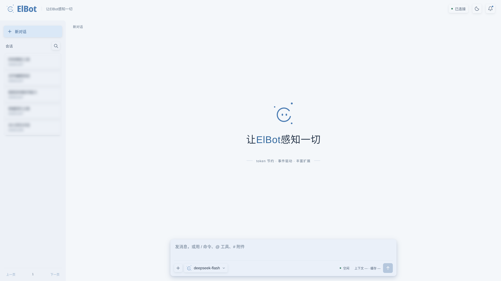
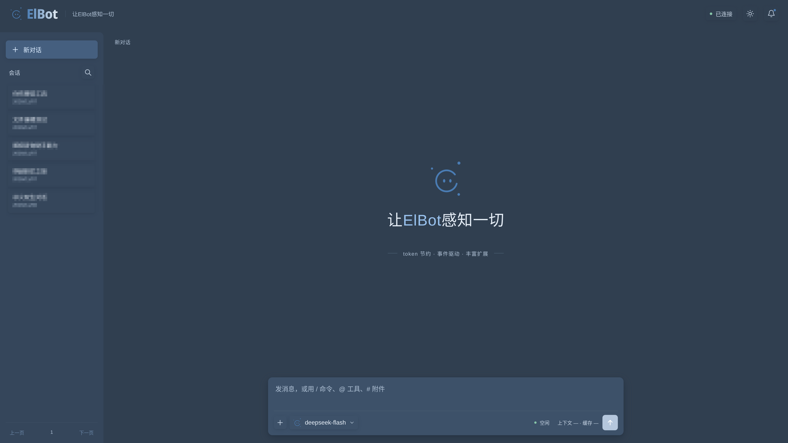
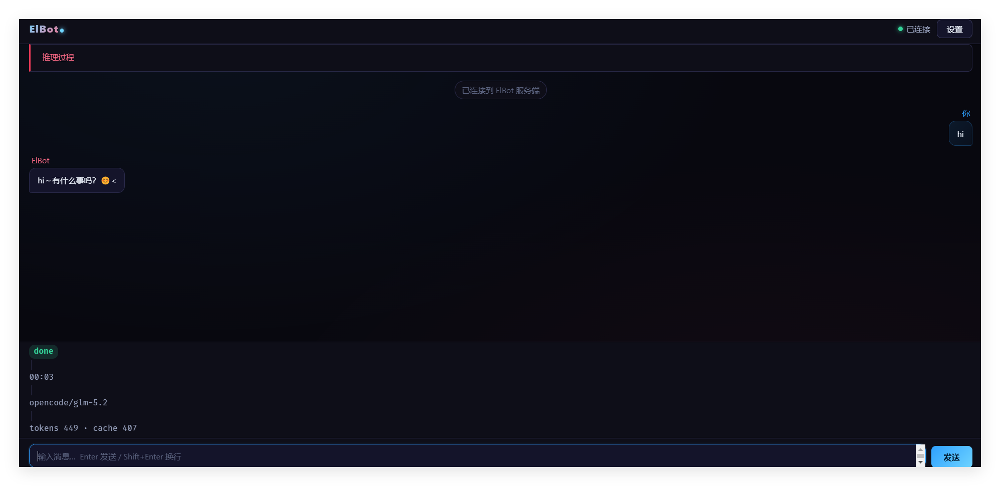
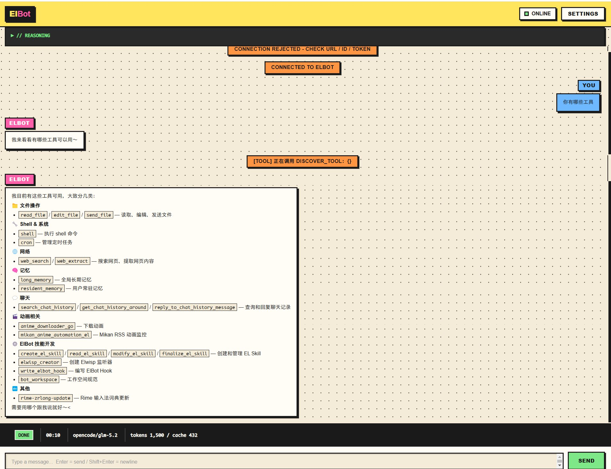
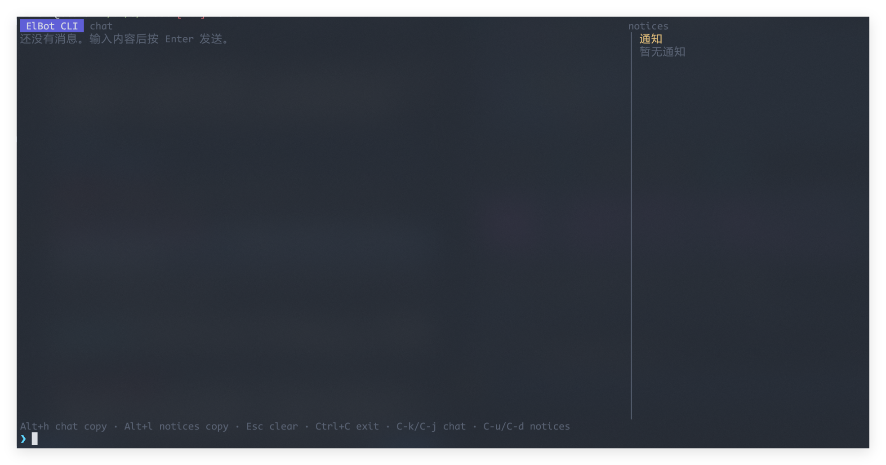

# ElBot Showcase

[ElBot](https://github.com/Elflare/elbot) 生态的 case 展示仓库。每个子目录是一个独立 showcase，有自己的 README。

## Showcases

| Showcase | 说明 |
|----------|------|
| [elwisp](elwisp/) | 外部事件监听——一条 curl 把任何外部信号接入 ElBot |
| [frontend](frontend/) | 聊天、日志与配置管理，包含完整 HTML、CSS、JavaScript 源码 |
| [frontend-concepts](frontend-concepts/) | Web 前端概念稿，展示不同的界面风格 |
| [hooks](hooks/) | Hook 插件示例——C / C++ / TypeScript 一次性脚本与 Python 持久 Hook |

更多 showcase 持续添加中。

## 前端预览

### 可运行的 Web 前端

下面是实际连接 ElBot 的浅色与深色主题，[完整源码与安装说明](frontend/) 已包含在本仓库中。支持聊天、日志查询、配置与 Provider 管理，以及会话搜索、历史懒加载、结构化状态卡和确认操作。

  
  

[查看 /status 状态卡示例](frontend/README.md#结构化状态卡)。

将本仓库的 `frontend/` 目录复制到 ElBot 主配置文件所在目录，启用 CLI 远程服务并重启后，即可通过其 HTTP 地址打开。页面与远程 CLI 共用监听端口，无需额外启动 Web 服务器。HTML、CSS 和 JavaScript 均由用户管理，可直接修改或替换。

### 概念稿与 TUI

前两张为 Web 前端概念稿，仅展示界面风格；第三张为 TUI 终端界面。全部四张 Web 概念稿见 [frontend-concepts](frontend-concepts/)。

  
  
  

---

# ElBot Showcase

A collection of showcases for the [ElBot](https://github.com/Elflare/elbot) ecosystem. Each subdirectory is an independent showcase with its own README.

## Showcases

| Showcase | Description |
|----------|-------------|
| [elwisp](elwisp/) | External event listener — one curl to feed any signal into ElBot |
| [frontend](frontend/) | Chat, logs, and configuration management with complete HTML, CSS, and JavaScript source |
| [frontend-concepts](frontend-concepts/) | Web frontend concepts exploring different interface styles |
| [hooks](hooks/) | Hook plugin examples — C / C++ / TypeScript one-shot scripts and a Python stateful Hook |

More showcases coming soon.

## Frontend Preview

### Runnable Web Frontend

These screenshots show the frontend connected to ElBot in light and dark themes. [Complete source and setup instructions](frontend/) are included, with chat, log queries, configuration and provider management, session search, paginated history, structured status cards, and confirmation actions.

  
  

[View the /status card example](frontend/README.md#structured-status-card).

Copy this repository's `frontend/` directory alongside ElBot's main configuration file, enable the remote CLI server, and restart ElBot. Open the server's HTTP address to use the page. The page shares the remote CLI server's listening port, so no additional web server is needed. Users manage the HTML, CSS, and JavaScript files and can edit or replace them directly.

### Concepts and TUI

The first two images are web frontend concepts illustrating interface styles; the third is the TUI. All four web concepts are preserved in [frontend-concepts](frontend-concepts/).

  
  
  

## License

MIT
