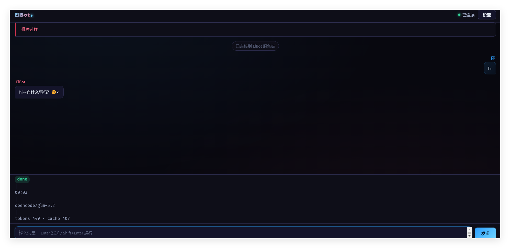
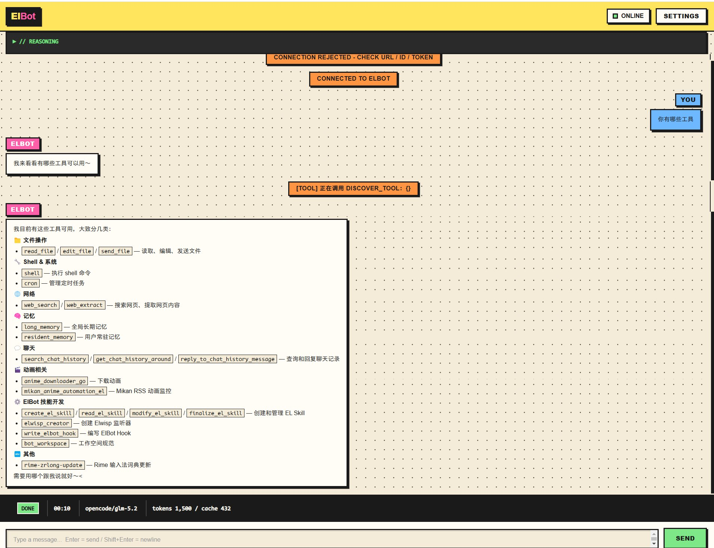
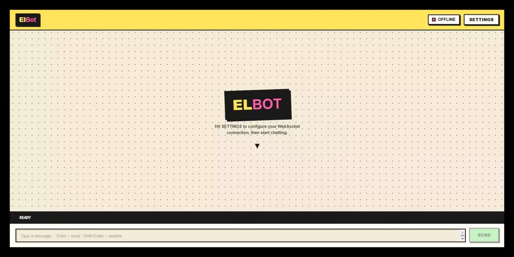
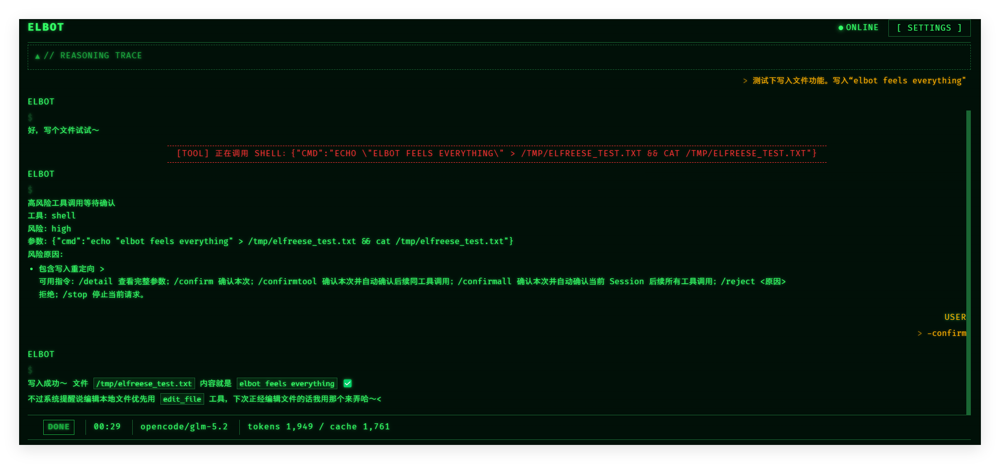

# Web 前端概念稿

这些截图是概念性 HTML mockup，用于展示 ElBot 可定制前端的不同界面风格，不附对应的可运行客户端源码。

本仓库另有[可运行的 Web 前端及完整源码](../frontend/)，可直接放入 ElBot 配置目录的 `frontend/` 文件夹使用。

| 图片 | 说明 |
|------|------|
|  | Web 前端概念 mockup |
|  | Web 前端概念 mockup |
|  | Web 前端概念 mockup |
|  | Web 前端概念 mockup |

---

# Web Frontend Concepts

These screenshots are conceptual HTML mockups exploring different styles for ElBot's customizable frontend. They do not include corresponding runnable client source.

A separate [runnable web frontend with complete source](../frontend/) can be installed in the ElBot configuration directory's `frontend/` folder.

| Image | Notes |
|-------|-------|
|  | Web frontend concept mockup |
|  | Web frontend concept mockup |
|  | Web frontend concept mockup |
|  | Web frontend concept mockup |
