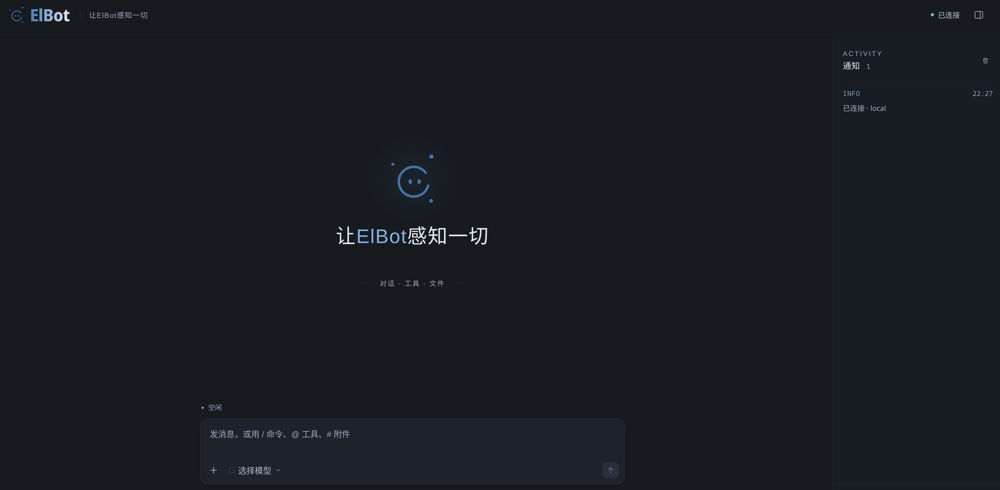

# ElBot Web Frontend

可运行的 ElBot 网页客户端，包含完整源码。使用普通 HTML、CSS 和 JavaScript，无需构建；Markdown 依赖也随源码提供，从本地加载。



这是实际连接 ElBot 的运行截图。其他界面概念稿单独保存在 [frontend-concepts](../frontend-concepts/)，TUI 截图见 [仓库首页](../README.md)。

## 功能

- 流式对话、可折叠思考过程、工具运行状态和独立通知栏。
- Markdown 渲染、代码复制和模型选择。
- Tab 补全 `/` 命令和 `@` 工具；`#` 补全当前待发送附件的文件名。
- 文件选择、拖放和粘贴上传，附件下载和图片预览。
- Client ID / Token 登录，凭据仅保留在当前页面内存中；消息不在刷新后恢复。

## 使用

需要支持 `frontend/` 静态托管及 CLI HTTP 附件接口的 ElBot 版本，接口见 [前端 API 文档](https://github.com/Elflare/elbot/blob/main/docs/frontend-api.md)。

1. 将本目录整体复制到 ElBot 主配置文件所在目录。例如，使用默认配置目录时，在本仓库根目录执行：

   ```sh
   cp -R frontend ~/.config/elbot/
   ```

   复制后入口应为 `~/.config/elbot/frontend/index.html`；自定义配置路径时，放在相应主配置文件旁。

2. 在现有 `app.toml` 中配置 CLI 远程服务；已有对应配置节时直接修改：

   ```toml
   [platform.cli]
   enabled = true

   [platform.cli.server]
   enabled = true
   listen = "127.0.0.1:32172"

   [platform.cli.server.tokens]
   my-client = ["ELBOT_CLI_TOKEN"]
   ```

3. 在服务进程环境或配置目录的 `.env` 中设置 `ELBOT_CLI_TOKEN` 的实际值，以服务模式启动或重启 ElBot（`elbot service run`）。
4. 打开 `http://127.0.0.1:32172/`，Client ID 填 `my-client`，Token 填环境变量的实际值。

页面通过 ElBot 自己的监听端口提供，无需另启 HTTP 服务器。聊天、状态和补全使用 WebSocket，附件收发使用同源 HTTP 接口；不用在前端填写服务地址。

Token 不写入源码或 URL。刷新页面后需要重新登录。

## 修改界面

```text
配置目录/
├── app.toml
├── .env
└── frontend/
    ├── index.html
    ├── app.css
    ├── app.js
    ├── assets/          # 网页使用的 logo
    └── vendor/          # 本地 Markdown 依赖和许可证
```

修改 HTML、CSS 或 JavaScript 后刷新页面即可；首次添加 `frontend/index.html` 后需要重启服务。也可添加其他实际 HTML 页面，按对应路径访问。ElBot 托管用户提供的文件，用户可以替换整个前端。

Markdown 由 Marked 解析，再由 DOMPurify 清理。依赖版本及许可见 [vendor/README.md](vendor/README.md)。

---

# ElBot Web Frontend

A runnable ElBot web client with complete source. It uses plain HTML, CSS, and JavaScript with no build step. Markdown dependencies are bundled and loaded locally.


This screenshot shows a live connection to ElBot. Interface concepts are kept separately in [frontend-concepts](../frontend-concepts/); the TUI screenshot is on the [repository homepage](../README.md).

## Features

- Streaming chat, collapsible reasoning, tool status, and a separate notification panel.
- Markdown rendering, code copying, and model selection.
- Tab completion for `/` commands and `@` tools; `#` completes filenames attached to the current draft.
- File picker, drag-and-drop and paste uploads, attachment downloads, and image previews.
- Client ID / Token login with credentials held only in page memory; messages do not survive a refresh.

## Setup

Use an ElBot version supporting `frontend/` static hosting and the CLI HTTP attachment endpoints. See the [frontend API documentation](https://github.com/Elflare/elbot/blob/main/docs/frontend-api.md).

1. Copy this entire directory alongside ElBot's main configuration file. For the default configuration directory, run from this repository's root:

   ```sh
   cp -R frontend ~/.config/elbot/
   ```

   The entry point should be `~/.config/elbot/frontend/index.html`. For custom configuration paths, place it alongside the corresponding main configuration file.

2. Configure the remote CLI server in the existing `app.toml`, editing existing sections if present:

   ```toml
   [platform.cli]
   enabled = true

   [platform.cli.server]
   enabled = true
   listen = "127.0.0.1:32172"

   [platform.cli.server.tokens]
   my-client = ["ELBOT_CLI_TOKEN"]
   ```

3. Set the actual `ELBOT_CLI_TOKEN` value in the service process environment or in the configuration directory's `.env`, then start or restart ElBot in service mode (`elbot service run`).
4. Open `http://127.0.0.1:32172/`, enter `my-client` as Client ID, and use the environment variable's actual value as Token.

ElBot serves the page on its own listening port; no additional HTTP server is required. Chat, status, and completion use WebSocket; attachments use same-origin HTTP endpoints. No server address needs to be configured in the frontend.

Keep tokens out of source files and URLs. Refreshing the page requires logging in again.

## Customization

Place `index.html`, `app.css`, `app.js`, `assets/`, and `vendor/` inside the configuration directory's `frontend/` folder, as shown above. Edit the HTML, CSS, or JavaScript and refresh to load changes. Restart the service after adding `frontend/index.html` for the first time. Additional HTML pages can be accessed by their file paths. ElBot serves user-provided files, so the entire frontend can be replaced.

Marked parses Markdown and DOMPurify sanitizes the result. Dependency versions and licenses are listed in [vendor/README.md](vendor/README.md).
