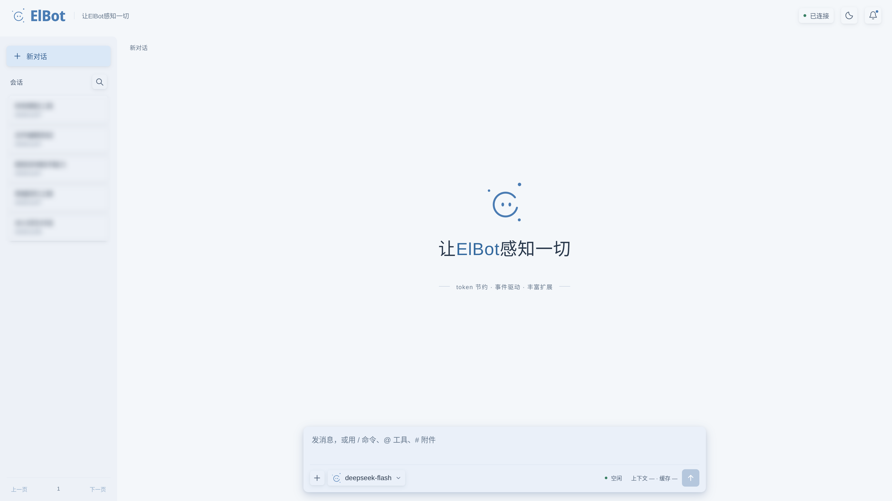
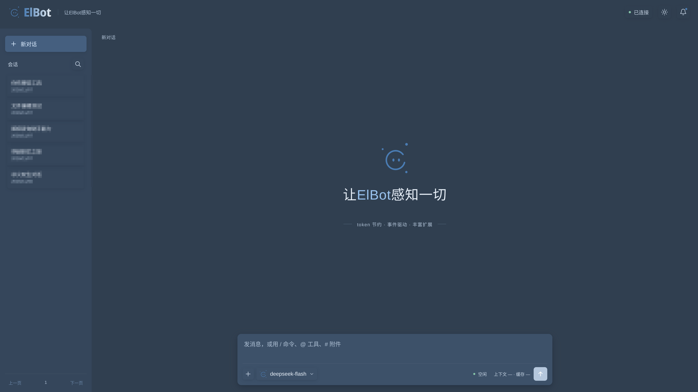
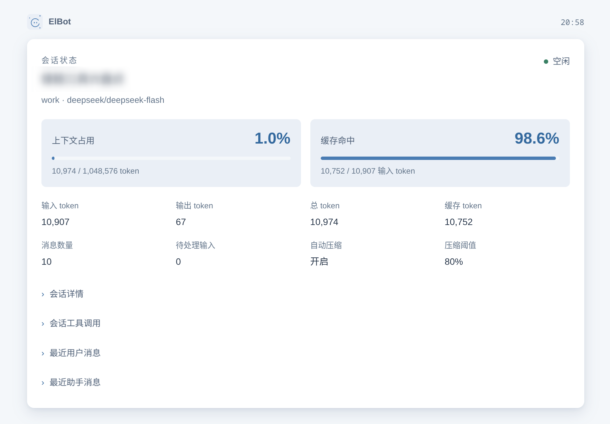

# ElBot Web Frontend

可运行的 ElBot 网页客户端，包含完整 HTML、CSS 和 JavaScript 源码，无需构建。将本目录放进 ElBot 配置目录的 `frontend/`，即可通过 ElBot 自己的端口访问，也可以直接修改或替换界面。

## 截图

### 浅色与深色主题

<p>
  
  
</p>

### 结构化状态卡



以上是实际连接 ElBot 的运行截图。其他界面概念稿见 [frontend-concepts](../frontend-concepts/)，TUI 截图见 [仓库首页](../README.md)。

## 功能

- 明暗主题切换、用户消息气泡、默认展开且可折叠的思考过程，以及独立通知栏。
- 会话列表、服务端搜索、点击恢复会话；历史消息从最新页开始，向上滚动加载更早内容。
- Markdown 渲染、代码与消息复制、当前模型显示与模型选择。
- Tab 补全 `/` 命令和 `@` 工具；`#` 补全当前待发送附件的文件名。
- 文件选择、拖放和粘贴上传，附件下载和图片预览。
- 结构化命令结果、`/status` 状态卡，以及输入框中的运行阶段、上下文占用率和缓存命中率。
- 确认操作可直接点击；拒绝按钮旁的箭头展开原因输入框，成功提交后收起。

## 使用

需要支持当前 CLI 远程协议、结构化 `command_result` 和 HTTP 附件接口的 ElBot 版本，见 [前端 API 文档](https://github.com/Elflare/elbot/blob/main/docs/frontend-api.md)。

1. 将本目录整体复制到 ElBot 主配置文件所在目录。例如，在本仓库根目录执行：

   ```sh
   cp -R frontend ~/.config/elbot/
   ```

   入口应为 `~/.config/elbot/frontend/index.html`；自定义主配置文件路径时，放在相应主配置文件旁。

2. 在现有 `app.toml` 中配置 CLI 远程服务；已有对应配置节时直接修改：

   ```toml
   [platform.cli]
   enabled = true

   [platform.cli.server]
   enabled = true
   listen = "127.0.0.1:32172"

   [platform.cli.server.tokens]
   my-client = ["ELBOT_CLI_TOKEN"]
   ```

3. 在服务进程环境或配置目录的 `.env` 中设置 `ELBOT_CLI_TOKEN` 的实际值，以服务模式启动或重启 ElBot：`elbot service run`。
4. 打开 `http://127.0.0.1:32172/`，Client ID 填 `my-client`，Token 填环境变量的实际值。

页面与远程 CLI 共用监听端口，无需另启 HTTP 服务器；前端从当前页面地址取得服务地址。

## 会话、登录与主题

首次认证成功后，页面静默执行 `/new` 解除当前会话绑定并显示欢迎页；发送消息时才创建新会话。点击侧栏会话则通过 `/resume` 恢复，并通过 `/messages` 分页读取历史。普通断线重连不会重复执行 `/new`，也不会自动重发输入。

Client ID 和 Token 保存在当前标签页的 `sessionStorage`，刷新后自动重新连接，退出时清除；不写入源码或 URL。聊天记录不在浏览器中持久化，刷新后从欢迎页开始，通过侧栏选择历史会话。历史附件只展示名称，不复用失效的下载凭据。

主题首次跟随系统，手动选择后将偏好保存在 `localStorage`。该存储只保存主题，不保存登录凭据。

## 当前协议

- WebSocket 使用同源 `/cli/v1/ws`，通过 `hello` / `hello_ok` 完成认证。
- `chat` 显示独立的完整回复；`stream` 按 `stream_id` 关联正文、推理和操作按钮。`finish` 只结束生成，`send` 用完整正文提交，`reset` 删除当前流的预览。
- 命令通过 `input` 发送，`command_result.request_id` 关联输入 ID。页面消费 `result.kind`、`result.data`、`result.confirmation` 和独立的 `error`，不解析通知文案推断结果。
- 操作按钮提交服务端返回的 `action.command`。权限和待确认状态仍由 ElBot 校验。
- `notice` 只展示运行通知；自动状态查询更新状态栏，不向聊天区或通知栏重复添加结果。
- 附件通过同源 `/cli/v1/files` 上传和获取，使用当前连接的 `media_token` 认证；断连后原凭据与附件授权失效。

完整字段、错误类别及示例以 [ElBot 前端 API](https://github.com/Elflare/elbot/blob/main/docs/frontend-api.md) 为准。

## 修改界面

```text
配置目录/
├── app.toml
├── .env
└── frontend/
    ├── index.html
    ├── app.css
    ├── app.js
    ├── assets/          # 网页使用的 Logo
    └── vendor/          # 本地 Markdown 依赖和许可证
```

修改 HTML、CSS 或 JavaScript 后刷新页面即可；首次添加 `frontend/index.html` 后需重启服务。也可添加其他实际 HTML 页面，按对应路径访问。Markdown 由 Marked 解析，再由 DOMPurify 清理，依赖及许可见 [vendor/README.md](vendor/README.md)。

---

# ElBot Web Frontend

A runnable ElBot web client with complete HTML, CSS, and JavaScript source and no build step. Place this directory alongside ElBot's main configuration file as `frontend/` to serve it on ElBot's own port. You can edit or replace the interface directly.

## Screenshots

### Light and dark themes

<p>
  
  
</p>

### Structured status card


These are screenshots of the client connected to ElBot. Interface concepts are in [frontend-concepts](../frontend-concepts/); the TUI screenshot is on the [repository homepage](../README.md).

## Features

- Light and dark themes, user message bubbles, reasoning expanded by default with a collapse control, and a separate notification panel.
- Session listing and server-side search, click to resume, and history loaded from the latest page with older messages fetched on upward scrolling.
- Markdown rendering, code and message copying, the current model name, and model selection.
- Tab completion for `/` commands and `@` tools; `#` completes filenames attached to the current draft.
- File picker, drag-and-drop and paste uploads, attachment downloads, and image previews.
- Structured command results, a `/status` card, and composer indicators for the current phase, context usage, and cache hit rate.
- Clickable confirmation actions; the arrow beside Reject opens an optional reason field that closes after a successful submission.

## Setup

Use an ElBot version supporting the current remote CLI protocol, structured `command_result` messages, and HTTP attachment endpoints. See the [frontend API documentation](https://github.com/Elflare/elbot/blob/main/docs/frontend-api.md).

1. Copy this entire directory alongside ElBot's main configuration file. From this repository's root:

   ```sh
   cp -R frontend ~/.config/elbot/
   ```

   The entry point should be `~/.config/elbot/frontend/index.html`. For a custom configuration path, place it alongside that main configuration file.

2. Configure the remote CLI server in the existing `app.toml`, editing existing sections if present:

   ```toml
   [platform.cli]
   enabled = true

   [platform.cli.server]
   enabled = true
   listen = "127.0.0.1:32172"

   [platform.cli.server.tokens]
   my-client = ["ELBOT_CLI_TOKEN"]
   ```

3. Set the actual `ELBOT_CLI_TOKEN` value in the service process environment or the configuration directory's `.env`, then start or restart ElBot with `elbot service run`.
4. Open `http://127.0.0.1:32172/`, enter `my-client` as Client ID, and use the environment variable's actual value as Token.

The page shares the remote CLI server's listening port; no additional HTTP server is required. The client derives the server address from the current page URL.

## Sessions, login, and theme

After the first successful authentication, the page silently sends `/new` to release the current session binding and shows the welcome page. A session is created only when you send a message. Select a session in the sidebar to `/resume` it and load history through `/messages`. An ordinary reconnect does not repeat `/new` or automatically resend input.

Client ID and Token are saved in the current tab's `sessionStorage`, restored on refresh, and cleared on logout. They are never included in source files or URLs. Chat history is not persisted in the browser: refresh starts at the welcome page, and the sidebar provides access to saved sessions. Historical attachments display names only and do not reuse expired download credentials.

The initial theme follows the system. A manual choice is saved in `localStorage`, which stores the theme preference only, not login credentials.

## Current protocol

- The same-origin `/cli/v1/ws` WebSocket authenticates with `hello` / `hello_ok`.
- `chat` carries an independent complete reply. `stream` associates text, reasoning, and actions by `stream_id`: `finish` ends generation, `send` commits the complete body, and `reset` removes that stream's preview.
- Commands use `input`; `command_result.request_id` identifies the original input. The client consumes `result.kind`, `result.data`, `result.confirmation`, and a separate `error`, rather than inferring outcomes from notification text.
- Action buttons submit the server-provided `action.command`. ElBot still checks permissions and pending confirmation state.
- `notice` carries runtime notifications. Automatic status queries update indicators without adding duplicate chat messages or notices.
- Attachments use the same-origin `/cli/v1/files` HTTP endpoints authenticated with the current connection's `media_token`. Disconnecting invalidates those credentials and attachment grants.

See the [ElBot frontend API](https://github.com/Elflare/elbot/blob/main/docs/frontend-api.md) for complete fields, error categories, and examples.

## Customization

Place `index.html`, `app.css`, `app.js`, `assets/`, and `vendor/` inside the configuration directory's `frontend/` folder, as shown above. Edit the HTML, CSS, or JavaScript and refresh to load changes. Restart ElBot after first adding `frontend/index.html`. Additional HTML pages are accessible by their file paths.

Marked parses Markdown and DOMPurify sanitizes the result. Bundled dependencies and licenses are listed in [vendor/README.md](vendor/README.md).
